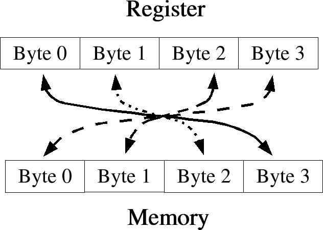
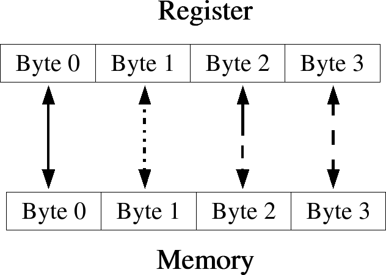

# Counting Like a Computer {#chapter-10-counting-like-a-computer}

Counting {#counting}
--------

### Counting Like a Human {#counting-like-a-human}

In many ways, computers count just like humans. So, before we start
learning how computers count, let\'s take a deeper look at how we count.

How many fingers do you have? No, it\'s not a trick question. Humans
(normally) have ten fingers. Why is that significant? Look at our
numbering system. At what point does a one-digit number become a
two-digit number? That\'s right, at ten. Humans count and do math using
a base ten numbering system. Base ten means that we group everything in
tens. Let\'s say we\'re counting sheep. 1, 2, 3, 4, 5, 6, 7, 8, 9, 10.
Why did we all of a sudden now have two digits, and re-use the 1?
That\'s because we\'re grouping our numbers by ten, and we have 1 group
of ten sheep. Okay, let\'s go to the next number 11. That means we have
1 group of ten sheep, and 1 sheep left ungrouped. So we continue - 12,
13, 14, 15, 16, 17, 18, 19, 20. Now we have 2 groups of ten. 21 - 2
groups of ten, and 1 sheep ungrouped. 22 - 2 groups of ten, and 2 sheep
ungrouped. So, let\'s say we keep counting, and get to 97, 98, 99, and
100. Look, it happened again! What happens at 100? We now have ten
groups of ten. At 101 we have ten groups of ten, and 1 ungrouped sheep.
So we can look at any number like this. If we counted 60879 sheep, that
would mean that we had 6 groups of ten groups of ten groups of ten
groups of ten, 0 groups of ten groups of ten groups of ten, 8 groups of
ten groups of ten, 7 groups of ten, and 9 sheep left ungrouped.

So, is there anything significant about grouping things by ten? No!
It\'s just that grouping by ten is how we\'ve always done it, because we
have ten fingers. We could have grouped at nine or at eleven (in which
case we would have had to make up a new symbol). The only difference
between the different groupings of numbers is that we have to re-learn
our multiplication, addition, subtraction, and division tables for each
grouping. The rules haven\'t changed, just the way we represent them.
Also, some of our tricks that we learned don\'t always apply, either.
For example, let\'s say we grouped by nine instead of ten. Moving the
decimal point one digit to the right no longer multiplies by ten, it now
multiplies by nine. In base nine, 500 is only nine times as large as 50.

### Counting Like a Computer {#counting-like-a-computer}

The question is, how many fingers does the computer have to count with?
The computer only has two fingers. So that means all of the groups are
groups of two. So, let\'s count in binary - 0 (zero), 1 (one), 10 (two -
one group of two), 11 (three - one group of two and one left over), 100
(four - two groups of two), 101 (five - two groups of two and one left
over), 110 (six - two groups of two and one group of two), and so on. In
base two, moving the decimal one digit to the right multiplies by two,
and moving it to the left divides by two. Base two is also
referred to as binary.

The nice thing about base two is that the basic math tables are very
short. In base ten, the multiplication tables are ten columns wide, and
ten columns tall. In base two, it is very simple:

Table of binary addition

    +----------------+
    | + ||  0  |  1  |
    |================|
    | 0 ||  0  |  1  |
    |----+-----+-----|
    | 1 ||  1  | 10  |
    +----------------+

Table of binary multiplication

    +----------------+
    | * ||  0  |  1  |
    |================|
    | 0 ||  0  |  0  |
    |----+-----+-----|
    | 1 ||  0  |  1  |
    +----------------+

So, let\'s add the numbers 10010101 with 1100101:

       10010101
    +   1100101
    -----------
       11111010

Now, let\'s multiply them:

           10010101
        *   1100101
        -----------
           10010101
          00000000
         10010101
        00000000
       00000000
      10010101
     10010101
    ---------------
     11101011001001

### Conversions Between Binary and Decimal {#conversions-between-binary-and-decimal}

Let\'s learn how to convert numbers from binary (base two)
to decimal (base ten). This is actually a rather simple
process. If you remember, each digit stands for some grouping of
two. So, we just need to add up what each digit represents, and we will
have a decimal number. Take the binary number 10010101. To find out what
it is in decimal, we take it apart like this:

     1    0    0    1    0    1    0    1
     |    |    |    |    |    |    |    |
     |    |    |    |    |    |    |    Individual units (2^0)
     |    |    |    |    |    |    0 groups of 2 (2^1)
     |    |    |    |    |    1 group of 4 (2^2)
     |    |    |    |    0 groups of 8 (2^3)
     |    |    |    1 group of 16 (2^4)
     |    |    0 groups of 32 (2^5)
     |    0 groups of 64 (2^6)
     1 group of 128 (2^7)

And then we add all of the pieces together, like this:

    1*128 + 0*64 + 0*32 + 1*16 + 0*8 + 1*4 + 0*2 + 1*1
    128 + 16 + 4 + 1 = 149

So 10010101 in binary is 149 in decimal. Let\'s look at 1100101. It can
be written as:

    1*64 + 1*32 + 0 * 16 + 0*8 + 1*4 + 0*2 + 1*1
    64 + 32 + 4 + 1 = 101

So we see that 1100101 in binary is 101 in decimal. Let\'s look at one
more number, 11101011001001. You can convert it to decimal by doing:

    1*8192 + 1*4096 + 1*2048 + 0*1024 + 1*512 + 0*256
           + 1*128 + 1*64 + 0*32 + 0*16 + 1*8 + 0*4
           + 0*2 + 1*1

    8192 + 4096 + 2048 + 512 + 128 + 64 + 8 + 1 = 15049

Now, if you\'ve been paying attention, you have noticed that the numbers
we just converted are the same ones we used to multiply with earlier.
So, let\'s check our results: 101 \* 149 = 15049. It worked!

Now let\'s look at going from decimal back to binary. In
order to do the conversion, you have to *divide* the number into groups
of two. So, let\'s say you had the number 17. If you divide it by two,
you get 8 with 1 left over. So that means there are 8 groups of two, and
1 ungrouped. That means that the rightmost digit will be 1. Now, we have
the rightmost digit figured out, and 8 groups of 2 left over. Now, let\'s
see how many groups of two groups of two we have, by dividing 8 by 2. We
get 4, with nothing left over. That means that all groups two can be
further divided into more groups of two. So, we have 0 groups of only
two. So the next digit to the left is 0. So, we divide 4 by 2 and get
two, with 0 left over, so the next digit is 0. Then, we divide 2 by 2
and get 1, with 0 left over. So the next digit is 0. Finally, we divide
1 by 2 and get 0 with 1 left over, so the next digit to the left is 1.
Now, there\'s nothing left, so we\'re done. So, the number we wound up
with is 10001.

Previously, we converted to binary 11101011001001 to decimal 15049.
Let\'s do the reverse to make sure that we did it right:

    15049 / 2 = 7524    Remaining 1
    7524 / 2 = 3762     Remaining 0
    3762 / 2 = 1881     Remaining 0
    1881 / 2 = 940      Remaining 1
    940 / 2 = 470       Remaining 0
    470 / 2 = 235       Remaining 0
    235 / 2 = 117       Remaining 1
    117 / 2 = 58        Remaining 1
    58 / 2 = 29         Remaining 0
    29 / 2 = 14         Remaining 1
    14 / 2 = 7          Remaining 0
    7 / 2 = 3           Remaining 1
    3 / 2 = 1           Remaining 1
    1 / 2 = 0           Remaining 1

Then, we put the remaining numbers back together, and we have the
original number! Remember the first division remainder goes to the far
right, so from the bottom up you have 11101011001001.

Each digit in a binary number is called a *bit*, which stands for
*binary digit*. Remember, computers divide up their memory
into storage locations called bytes. Each storage location on an
x86 processor (and most others) is 8 bits long. Earlier we said that a
byte can hold any number between 0 and 255. The reason for this is that
the largest number you can fit into 8 bits is 255. You can see this for
yourself if you convert binary 11111111 into decimal:


    11111111 = (1 * 2^7) + (1 * 2^6) + (1 * 2^5) + (1 * 2^4)
               + (1 * 2^3)+ (1 * 2^2) + (1 * 2^1) + (1 * 2^0)

    128 + 64 + 32 + 16 + 8 + 4 + 2 + 1 = 255

The largest number that you can hold in 16 bits is 65,535. The largest
number you can hold in 32 bits is 4,294,967,295 (4 billion). The largest
number you can hold in 64 bits is 18,446,744,073,709,551,615. The
largest number you can hold in 128 bits is
340,282,366,920,938,463,463,374,607,431,768,211,456. Anyway, you see the
picture. For x86 processors, most of the time you will deal with 4-byte
numbers (32 bits), because that\'s the size of the registers.

Truth, Falsehood, and Binary Numbers {#truth-falsehood-and-binary-numbers}
------------------------------------

Now we\'ve seen that the computer stores everything as sequences of 1\'s
and 0\'s. Let\'s look at some other uses of this. What if, instead of
looking at a sequence of bits as a number, we instead looked at it
as a set of switches. For example, let\'s say there are four
switches that control lighting in the house. We have a switch for
outside lights, a switch for the hallway lights, a switch for the living
room lights, and a switch for the bedroom lights. We could make a little
table showing which of these were on and off, like so:

    Outside  Hallway  Living Room  Bedroom
      On       Off        On         On

It\'s obvious from looking at this that all of the lights are on except
the hallway ones. Now, instead of using the words \"On\" and \"Off\",
let\'s use the numbers 1 and 0. 1 will represent on, and 0 will
represent off. So, we could represent the same information as:

    Outside  Hallway  Living Room  Bedroom
       1        0           1         1

Now, instead of having labels on the light switches, let\'s say we just
memorized which position went with which switch. Then, the same
information could be represented as:

       1        0           1         1

Or as:

    1011

This is just one of many ways you can use the computers storage
locations to represent more than just numbers. The computer\'s memory just
sees numbers, but programmers can use these numbers to represent
anything their imaginations can come up with. They just sometimes have
to be creative when figuring out the best representation.

Not only can you do regular arithmetic with binary numbers, they also
have a few operations of their own, called binary operations or
logical operations. The standard binary operations
are:

-   AND.

-   OR.

-   NOT.

-   XOR.

Before we look at examples, I\'ll describe them for you. AND takes two
bits and returns one bit. AND will return a 1 only if both bits are 1,
and a 0 otherwise. For example, 1 AND 1 is 1, but 1 AND 0 is 0, 0 AND 1
is 0, and 0 AND 0 is 0.

OR takes two bits and returns one bit. It will return 1 if either of the
original bits is 1. For example, 1 OR 1 is 1, 1 OR 0 is one, 0 OR 1 is
1, but 0 OR 0 is 0.

NOT only takes one bit and returns its opposite. NOT 1 is 0 and NOT 0 is
1.

Finally, XOR is like OR, except it returns 0 if both bits are 1.

Computers can do these operations on whole registers at a time. For
example, if a register has 10100010101010010101101100101010 and another
one has 10001000010101010101010101111010, you can run any of these
operations on the whole registers. For example, if we were to AND them,
the computer will run from the first bit to the 32nd and run the AND
operation on that bit in both registers. In this case:

    10100010101010010101101100101010 AND
    10001000010101010101010101111010
    --------------------------------
    10000000000000010101000100101010

You\'ll see that the resulting set of bits only has a one where *both*
numbers had a one, and in every other position it has a zero. Let\'s
look at what an OR looks like:

    10100010101010010101101100101010 OR
    10001000010101010101010101111010
    --------------------------------
    10101010111111010101111101111010

In this case, the resulting number has a 1 where either number has a 1
in the given position. Let\'s look at the NOT operation:

    10100010101010010101101100101010 NOT
    ------------------------------------
    01011101010101101010010011010101

This just reverses each digit. Finally, we have XOR, which is like an
OR, except if *both* digits are 1, it returns 0.

    10100010101010010101101100101010 XOR
    10001000010101010101010101111010
    --------------------------------
    00101010111111000000111001010000

This is the same two numbers used in the OR operation, so you can
compare how they work. Also, if you XOR a number with itself, you will
always get 0, like this:

    10100010101010010101101100101010 XOR
    10100010101010010101101100101010
    --------------------------------
    00000000000000000000000000000000

These operations are useful for two reasons:

-   The computer can do them extremely fast.

-   You can use them to compare many truth values at the same time.

You may not have known that different instructions execute at different
speeds. It\'s true, they do. And these operations are the fastest on
most processors. For example, you saw that XORing a number with itself
produces 0. Well, the XOR operation is faster than the loading
operation, so many programmers use it to load a register with
zero. For example, the code:

```{.gnuassembler .numberLines}
movl  $0, %eax
```

Is often replaced by:

```{.gnuassembler .numberLines}
xorl  %eax, %eax
```

We\'ll discuss speed more in
[Chapter 12. Optimization](12-optimization.qmd#chapter-12-optimization), but I want you to
see how programmers often do tricky things, especially with these binary
operators, to make things fast. Now let\'s look at how we can use these
operators to manipulate true/false values. Earlier we discussed
how binary numbers can be used to represent any number of things. Let\'s
use binary numbers to represent what things my Dad and I like. First,
let\'s look at the things I like:

    Food: Yes
    Heavy Metal Music: Yes
    Wearing Dressy Clothes: No
    Football: Yes

Now, let\'s look at what my Dad likes:

    Food: Yes
    Heavy Metal Music: No
    Wearing Dressy Clothes: Yes
    Football: Yes

Now, let\'s use a 1 to say yes we like something, and a 0 to say no we
don\'t. Now we have:

    Me
    Food: 1
    Heavy Metal Music: 1
    Wearing Dressy Clothes: 0
    Football: 1

    Dad
    Food: 1
    Heavy Metal Music: 0
    Wearing Dressy Clothes: 1
    Football: 1

Now, if we just memorize which position each of these are in, we have:

    Me
    1101

    Dad
    1011

Now, let\'s see we want to get a list of things both my Dad and I like.
You would use the AND operation. So:

    1101 AND
    1011
    --------
    1001

Which translates to:

    Things we both like
    Food: Yes
    Heavy Metal Music: No
    Wearing Dressy Clothes: No
    Football: Yes

Remember, the computer has no idea what the ones and zeroes represent.
That\'s your job and your program\'s job. If you wrote a program around
this representation your program would at some point examine each bit
and have code to tell the user what it\'s for (if you asked a computer
what two people agreed on and it answered 1001, it wouldn\'t be very
useful). Anyway, let\'s say we want to know the things that we disagree
on. For that we would use XOR, because it will return 1 only if one
or the other is 1, but not both. So:

    1101 XOR
    1011
    --------
    0110

And I\'ll let you translate that back out.

The previous operations: AND, OR, NOT, and XOR are called *boolean
operators* because they were first studied by George
Boole. So, if someone mentions boolean operators or
boolean algebra, you now know what they are talking
about.

In addition to the boolean operations, there are also two binary
operators that aren\'t boolean, shift and
rotate. Shifts and rotates each do what their name implies, and
can do so to the right or the left. A left shift moves each digit of a
binary number one space to the left, puts a zero in the ones spot, and
chops off the furthest digit to the left. A left rotate does the same
thing, but takes the furthest digit to the left and puts it in the ones
spot. For example:

**Shift left:**

    # Logic and Arithmetic
    Binary:       1 0 0 1 0 1 1 1       = 151 | -105 | 0x97
                   / / / / / / /
    Result:       0 0 1 0 1 1 1 0 <- 0  =  46 |   46 | 0x2e

**Shift right:**

    # Logic
    Binary:       1 0 0 1 0 1 1 1       = 151 | -105 | 0x97
                   \ \ \ \ \ \ \
    Result:  0 -> 0 1 0 0 1 0 1 1       =  75 |   75 | 0x4b

    # Arithmetic
    Binary:       1 0 0 1 0 1 1 1       = 151 | -105 | 0x97
                  |\ \ \ \ \ \ \
    Result:       1 1 0 0 1 0 1 1       = 203 |  -53 | 0xcb

**Rotate left:**

    Binary:     ->1 0 0 1 0 1 1 1       = 151 | -105 | 0x97
                   / / / / / / /
    Result:       0 0 1 0 1 1 1 1<-     =  47 |   47 | 0x2f

**Rotate right:**

    Binary:       1 0 0 1 0 1 1 1<-     = 151 | -105 | 0x97
                   \ \ \ \ \ \ \
    Result:     ->1 1 0 0 1 0 1 1       = 203 |  -53 | 0xcb

Notice that if you rotate a number for every digit it has (i.e. -
rotating a 32-bit number 32 times), you wind up with the same number you
started with. However, if you *shift* a number for every digit you have,
you wind up with 0. So, what are these shifts useful for? Well, if you
have binary numbers representing things, you use shifts to peek at each
individual value. Let\'s say, for instance, that we had my Dad\'s likes
stored in a register (32 bits). It would look like this:

    00000000000000000000000000001011

Now, as we said previously, this doesn\'t work as program output. So, in
order to do output, we would need to do shifting and
*masking*. Masking is the process of eliminating everything you
don\'t want. In this case, for every value we are looking for, we will
shift the number so that value is in the ones place, and then mask that
digit so that it is all we see. Masking is accomplished by doing an
AND with a number that has the bits we are interested in set to 1.
For example, let\'s say we wanted to print out whether my Dad likes
dressy clothes or not. That data is the second value from the right. So,
we have to shift the number right 1 digit so it looks like this:

    00000000000000000000000000000101

And then, we just want to look at that digit, so we mask it by ANDing it
with `00000000000000000000000000000001`.

    00000000000000000000000000000101 AND
    00000000000000000000000000000001
    -----------------------------------
    00000000000000000000000000000001

This will make the value of the register 1 if my Dad likes dressy
clothes, and 0 if he doesn\'t. Then we can do a comparison to 1 and
print the results. The code would look like this:

```{.gnuassembler .numberLines include=resource/asm/010-01-shift-bit.s}
```

And then we would have two labels which printed something about whether
or not he likes dressy clothes and then exits. The `0b` notation means
that what follows is a binary number. In this case it
wasn\'t needed, because 1 is the same in any numbering system, but I put
it there for clarity. We also didn\'t need the 31 zeroes, but I put them
in to make a point that the number you are using is 32 bits.

When a number represents a set of options for a function or
system call, the individual true/false elements are called
*flags*. Many system calls have numerous options that are all set
in the same register using a mechanism like we\'ve described. The
`open` system call, for example, has as its second parameter a list
of flags to tell the operating system how to open the file. Some of the
flags include:

`O_WRONLY`:

:   This flag is `0b00000000000000000000000000000001` in binary, or `01`
    in octal (or any number system for that matter). This says to open
    the file in write-only mode.

`O_RDWR`:

:   This flag is `0b00000000000000000000000000000010` in binary, or `02`
    in octal. This says to open the file for both reading and writing.

`O_CREAT`:

:   This flag is `0b00000000000000000000000001000000` in binary, or
    `0100` in octal. It means to create the file if it doesn\'t already
    exist.

`O_TRUNC`:

:   This flag is `0b00000000000000000000001000000000` in binary, or
    `01000` in octal. It means to erase the contents of the file if the
    file already exists.

`O_APPEND`:

:   This flag is `0b00000000000000000000010000000000` in binary, or
    `02000` in octal. It means to start writing at the end of the file
    rather than at the beginning.

To use these flags, you simply OR them together in the combination
that you want. For example, to open a file in write-only mode, and have
it create the file if it doesn\'t exist, I would use `O_WRONLY` (01) and
`O_CREAT` (0100). OR\'d together, I would have 0101.

Note that if you don\'t set either `O_WRONLY` or `O_RDWR`, then the file
is automatically opened in read-only mode (`O_RDONLY`, except that it
isn\'t really a flag since it\'s zero).

Many functions and system calls use flags for options, as it allows a
single word to hold up to 32 possible options if each option is
represented by a single bit.

The Program Status Register {#the-program-status-register}
---------------------------

We\'ve seen how bits on a register can be used to give the answers of
yes/no and true/false statements. On your computer, there is a register
called the *program status register*. This
register holds a lot of information about what happens in a computation.
For example, have you ever wondered what would happen if you added two
numbers and the result was larger than would fit in a register? The
program status register has a flag called the carry flag. You
can test it to see if the last computation overflowed the register.
There are flags for a number of different statuses. In fact, when you do
a compare (`cmpl`) instruction, the result is stored in this
register. The conditional jump instructions (`jge`,
`jne`, etc) use these results to tell whether or not they should jump.
`jmp`, the unconditional jump, doesn\'t care what
is in the status register, since it is unconditional.

Let\'s say you needed to store a number larger than 32 bits. So, let\'s
say the number is 2 registers wide, or 64 bits. How could you handle
this? If you wanted to add two 64-bit numbers, you would add the least
significant registers first. Then, if you detected a carry, you could
add 1 to the most significant register. In fact, this is probably the
way you learned to do decimal addition. If the result in one column is
more than 9, you simply carried the number to the next most significant
column. If you added 65 and 37, first you add 7 and 4 to get 12. You
keep the 2 in the right column, and carry the one to the next column.
There you add 6, 3, and the 1 you carried. This results in 10. So, you
keep the zero in that column and carry the one to the next most
significant column, which is empty, so you just put the one there.
Luckily, 32 bits is usually big enough to hold the numbers we use
regularly.

Additional program status register flags are examined in
[Appendix B. Common x86 Instructions](appendix-b-common-x86-instructions.qmd#appendix-b-common-x86-instructions).

Other Numbering Systems {#other-numbering-systems}
-----------------------

What we have studied so far only applies to positive integers. However,
real-world numbers are not always positive integers. Negative numbers
and numbers with decimals are also used.

### Floating-point Numbers {#floating-point-numbers}

So far, the only numbers we\'ve dealt with are integers - numbers with
no decimal point. Computers have a general problem with numbers with
decimal points, because computers can only store fixed-size, finite
values. Decimal numbers can be any length, including infinite length
(think of a repeating decimal, like the result of 1 / 3).

The way a computer handles decimals is by storing them at a fixed
precision (number of significant bits). A computer stores
decimal numbers in two parts - the *exponent* and the
*mantissa*. The mantissa contains the actual digits that will be
used, and the exponent is what magnitude the number is. For example,
12345.2 can be represented as 1.23452 \* 10\^4. The mantissa is 1.23452
and the exponent is 4 with a base of 10. Computers, however, use a base
of 2. All numbers are stored as X.XXXXX \* 2\^XXXX. The number 1, for
example, is stored as 1.00000 \* 2\^0. Separating the mantissa and the
exponent into two different values is called a *floating point*
representation, because the position of the significant digits
with respect to the decimal point can vary based on the exponent.

Now, the mantissa and the exponent are only so long, which leads to some
interesting problems. For example, when a computer stores an integer, if
you add 1 to it, the resulting number is one larger. This does not
necessarily happen with floating point numbers. If the number is
sufficiently big, adding 1 to it might not even register in the mantissa
(remember, both parts are only so long). This affects several things,
especially order of operations. If you add 1.0 to a given floating point
number, it might not even affect the number if it is large enough. For
example, on x86 platforms, a four-byte floating-point number, although
it can represent very large numbers, cannot have 1.0 added to it past
16777216.0, because it is no longer significant. The number no longer
changes when 1.0 is added to it. So, if there is a multiplication
followed by an addition it may give a different result than if the
addition is performed first.

You should note that it takes most computers a lot longer to do
floating-point arithmetic than it does integer arithmetic. So, for
programs that really need speed, integers are mostly used.

Short floating-point:

- The first bit is the sign bit: 0 for positive and 1 for negative.

- The next 8 bits are the exponent. Follow this formula
  `2^(x - 127) = exponent`.

- The last 23 bits are the fraction of the mantissa. For normal
  numbers, the mantissa is `1.fraction` in binary: the leading 1 is
  always there, so it is not stored.

Example:

    0xC3478100
    Binary:      1 10000110 10001111000000100000000
    Sign bit:    1 -> -1
    Exponent:    10000110 -> 134 -> 2^(134 - 127) -> 128
    Mantissa:    1.10001111000000100000000 -> 1.558624267578125
    Value:       -1 * 128 * 1.558624267578125
                 = -199.50390625

    0x43478100
    Binary:      0 10000110 10001111000000100000000
    Sign bit:    0 -> 1
    Exponent:    10000110 -> 134 -> 2^(134 - 127) -> 128
    Mantissa:    1.10001111000000100000000 -> 1.558624267578125
    Value:       1 * 128 * 1.558624267578125
                 = 199.50390625

References to understand in deep how the computer handle the floating points.

- [Fixed Point and Floating Point][10-fixed-point-and-floating].

- [Floating Point Tutorial][10-floating-point-tutorial].

- [IEEE Standard for Floating-Point Arithmetic (IEEE 754)][10-IEEE-standard-for-floating].

- [Single-precision floating-point format][10-single-precision-floating].

For more information on using floating point numbers in assembly language, see:

- [Floating Point Assembly Language][10-floating-point-assembly].

- [Floating-Point Instruction Set][10-floating-point-instruction].

### Negative Numbers {#negative-numbers}

How would you think that negative numbers on a computer
might be represented? One thought might be to use the first digit of a
number as the sign, so `00000000000000000000000000000001` would
represent the number 1, and `10000000000000000000000000000001` would
represent -1. This makes a lot of sense, and in fact some old processors
work this way. However, it has some problems. First of all, it takes a
lot more circuitry to add and subtract signed numbers represented this
way. Even more problematic, this representation has a problem with the
number 0. In this system, you could have both a negative and a positive
0. This leads to a lot of questions, like \"should negative zero be
equal to positive zero?\", and \"What should the sign of zero be in
various circumstances?\".

These problems were overcome by using a representation of negative
numbers called *two\'s complement* representation. To
get the negative representation of a number in two\'s complement form,
you must perform the following steps:

1.  Perform a NOT operation on the number.

2.  Add one to the resulting number.

So, to get the negative of `00000000000000000000000000000001`, you would
first do a NOT operation, which gives
`11111111111111111111111111111110`, and then add one, giving
`11111111111111111111111111111111`. To get negative two, first take
`00000000000000000000000000000010`. The NOT of that number is
`11111111111111111111111111111101`. Adding one gives
`11111111111111111111111111111110`. With this representation, you can
add numbers just as if they were positive, and come out with the right
answers. For example, if you add one plus negative one in binary, you
will notice that all of the numbers flip to zero. Also, the first digit
still carries the sign bit, making it simple to determine whether or
not the number is positive or negative. Negative numbers will always
have a `1` in the leftmost bit. This also changes which numbers are
valid for a given number of bits. With signed numbers, the possible
magnitude of the values is split to allow for both positive and negative
numbers. For example, a byte can normally have values up to 255. A
signed byte, however, can store values from -128 to 127.

One thing to note about the two\'s complement
representation of signed numbers is that, unlike unsigned
quantities, if you increase the number of bits, you can\'t just add
zeroes to the left of the number. For example, let\'s say we are dealing
with four-bit quantities and we had the number -3, `1101`. If we were to
extend this into an eight-bit register, we could not represent it as
`00001101` as this would represent 13, not -3. When you increase the
size of a signed quantity in two\'s complement representation, you have
to perform *sign extension*. Sign extension means that you
have to pad the left-hand side of the quantity with whatever digit is in
the sign digit when you add bits. So, if we extend a negative number by
4 digits, we should fill the new digits with a 1. If we extend a
positive number by 4 digits, we should fill the new digits with a 0. So,
the extension of -3 from four to eight bits will yield `11111101`.

The x86 processor has different forms of several instructions depending
on whether they expect the quantities they operate on to be signed
or unsigned. These are listed in
[Appendix B. Common x86 Instructions](appendix-b-common-x86-instructions.qmd#appendix-b-common-x86-instructions).
For example, the x86 processor has both a sign-preserving shift-right,
`sarl`, and a shift-right which does not preserve the sign bit,
`shrl`.

Octal and Hexadecimal Numbers {#octal-and-hexadecimal-numbers}
-----------------------------

The numbering systems discussed so far have been decimal and
binary. However, two others are used common in computing -
octal and hexadecimal. In fact, they are probably
written more often than binary. Octal is a representation that only uses
the numbers 0 through 7. So the octal number 10 is actually 8 in decimal
because it is one group of eight. Octal 121 is decimal 81 (one group of
64 (8\^2), two groups of 8, and one left over). What makes octal nice is
that every 3 binary digits make one octal digit (there is no such
grouping of binary digits into decimal). So 0 is 000, 1 is 001, 2 is
010, 3 is 011, 4 is 100, 5 is 101, 6 is 110, and 7 is 111.

Permissions in Linux are done using octal. This is because
Linux permissions are based on the ability to read, write and execute.
The first bit is the read permission, the second bit is the write
permission, and the third bit is the execute permission. So, 0 (000)
gives no permissions, 6 (110) gives read and write permission, and 5
(101) gives read and execute permissions. These numbers are then used
for the three different sets of permissions - the owner, the group, and
everyone else. The number 0644 means read and write for the first
permission set, and read-only for the second and third set. The first
permission set is for the owner of the file. The third permission set is
for the group owner of the file. The last permission set is for everyone
else. So, `0751` means that the owner of the file can read, write, and
execute the file, the group members can read and execute the file, and
everyone else can only execute the file.

Anyway, as you can see, octal is used to group bits (binary digits) into
threes. The way the assembler knows that a number is octal is because
octal numbers are prefixed with a zero. For example 010 means 10 in
octal, which is 8 in decimal. If you just write 10 that means 10 in
decimal. The beginning zero is what differentiates the two. So, *be
careful not to put any leading zeroes in front of decimal numbers, or
they will be interpreted as octal numbers*!

Hexadecimal numbers (also called just \"hex\") use the numbers 1-15 for
each digit. however, since 10-15 don\'t have their own numbers,
hexadecimal uses the letters `a` through `f` to represent them. For
example, the letter `a` represents 10, the letter `b` represents 11, and
so on. 10 in hexadecimal is 16 in decimal. In octal, each digit
represented three bits. In hexadecimal, each digit represents
four bits. Every two digits is a full byte, and eight digits is a
32-bit word. So you see, it is considerably easier to write a
hexadecimal number than it is to write a binary number, because it\'s
only a quarter as many digits. The most important number to remember in
hexadecimal is `f`, which means that all bits are set. So, if I want to
set all of the bits of a register to 1, I can just do:

```{.gnuassembler}
movl  $0xFFFFFFFF, %eax
```

Which is considerably easier and less error-prone than writing:

```{.gnuassembler}
movl  $0b11111111111111111111111111111111, %eax
```

Note also that hexadecimal numbers are prefixed with `0x`.
So, when we do

```{.gnuassembler}
int   $0x80
```

We are calling interrupt number 128 (8 groups of 16), or interrupt
number `0b00000000000000000000000010000000`.

Hexadecimal and octal numbers take some getting used to, but they are
heavily used in computer programming. It might be worthwhile to make up
some numbers in hex and try to convert them back and forth to binary,
decimal, and octal.

Order of Bytes in a Word {#order-of-bytes-in-a-word}
------------------------

One thing that confuses many people when dealing with bits and
bytes on a low level is that, when bytes are written from
registers to memory, their bytes are written out
least-significant-portion-first.[^10-1] What most people expect is that if
they have a word in a register, say `0x5d 23 ef ee` (the spacing is so
you can see where the bytes are), the bytes will be written to memory in
that order. However, on x86 processors, the bytes are actually written
in reverse order. In memory the bytes would be `0xee ef 23 5d` on x86
processors. The bytes are written in reverse order from what they would
appear conceptually, but the bits within the bytes are ordered normally.

Not all processors behave this way. The x86 processor is a
*little-endian* processor, which means that it stores the
\"little end\", or least-significant byte of its words first.



Other processors are *big-endian* processors, which means that
they store the \"big end\", or most significant byte, of their words
first, the way we would naturally read a number.



This difference is not normally a problem (although it has sparked many
technical controversies throughout the years). Because the bytes are
reversed again (or not, if it is a big-endian processor) when being read
back into a register, the programmer usually never notices what
order the bytes are in. The byte-switching magic happens automatically
behind the scenes during register-to-memory transfers. However, the byte
order can cause problems in several instances:

-   If you try to read in several bytes at a time using `movl` but deal
    with them on a byte-by-byte basis using the least significant byte
    (i.e. - by using _%al_ and/or shifting of the register), this will be
    in a different order than they appear in memory.

-   If you read or write files written for different architectures, you
    may have to account for whatever order they write their bytes in.

-   If you read or write to network sockets, you may have to account for
    a different byte order in the protocol.

As long as you are aware of the issue, it usually isn\'t a big deal. For
more in-depth look at byte order issues, you should read
[DAV\'s Endian FAQ][10-Davs], especially the article
[\"On Holy Wars and a Plea for Peace\" by Daniel Cohen][10-Holy-war].

Converting Numbers for Display {#converting-numbers-for-display}
------------------------------

So far, we have been unable to display any number stored to the user,
except by the extremely limited means of passing it through exit codes.
In this section, we will discuss converting positive numbers into
strings for display.

The function will be called `_integer2string`, and it will take two
parameters - an integer to convert and a string buffer filled with null
characters (zeroes). The buffer will be assumed to be big enough to
store the entire number as a string (at least 11 characters long, to
include a trailing null character).

Remember that the way that we see numbers is in base 10. Therefore, to
access the individual decimal digits of a number, we need to be dividing
by 10 and displaying the remainder for each digit. Therefore, the
process will look like this:

-   Divide the number by ten.

-   The remainder is the current digit. Convert it to a character and
    store it.

-   We are finished if the quotient is zero.

-   Otherwise, take the quotient and the next location in the buffer and
    repeat the process.

The only problem is that since this process deals with the one\'s place
first, it will leave the number backwards. Therefore, we will have to
finish by reversing the characters. We will do this by storing the
characters on the stack as we compute them. This way, as we pop them
back off to fill in the buffer, it will be in the reverse order that we
pushed them on.

The code for the function should be put in a file called
`010-02-integer-to-string.s` and should be entered as follows:

```{.gnuassembler .numberLines include=resource/asm/010-02-integer-to-string.s}
```

To show this used in a full program, use the following code, along with
the `_count_chars` and `_write_newline` functions written about in
previous chapters. The code should be in a file called
`010-02-conversion-program.s`.

```{.gnuassembler .numberLines include=resource/asm/010-02-conversion-program.s}
```

To build the program, issue the following commands:

```{.bash}
as -o 010-02-integer-to-number.o   --32 \
                                   --gstabs+ \
                                   010-02-integer-to-string.s

as -o 006-01-count-chars.o         --32 \
                                   --gstabs+ \
                                   006-01-count-chars.s

as -o 006-01-write-newline.o       --32 \
                                   --gstabs+ \
                                   006-01-write-newline.s

as -o 010-02-conversion-program.o  --32 \
                                   --gstabs+ \
                                   010-02-conversion-program.s

ld -o 010-02-conversion-program    -m elf_i386 \
                                   006-01-count-chars.o \
                                   006-01-write-newline.o \
                                   010-02-conversion-program.o \
                                   010-02-integer-to-number.o
```

To run just type `./010-02-conversion-program` and the output should say `824`.

Review {#review-8}
------

### Know the Concepts {#know-the-concepts-8}

-   Convert the decimal number 5,294 to binary.

-   What number does 0x0234aeff represent? Specify in binary, octal, and
    decimal.

-   Add the binary numbers 10111001 and 101011.

-   Multiply the binary numbers 1100 1010110.

-   Convert the results of the previous two problems into decimal.

-   Describe how AND, OR, NOT, and XOR work.

-   What is masking for?

-   What number would you use for the flags of the `open` system call if
    you wanted to open the file for writing, and create the file if it
    doesn\'t exist?

-   How would you represent -55 in a 32-bit register?

-   Sign-extend the previous quantity into a 64-bit register.

-   Describe the difference between little-endian and big-endian storage
    of words in memory.

### Use the Concepts {#use-the-concepts-8}

-   Go back to previous programs that returned numeric results through
    the exit status code, and rewrite them to print out the results
    instead using our integer to string conversion function.

-   Modify the `_integer2string` code to return results in octal rather
    than decimal.

-   Modify the `_integer2string` code so that the conversion base is a
    parameter rather than hardcoded.

-   Write a function called `_is_negative` that takes a single integer as
    a parameter and returns 1 if the parameter is negative, and 0 if the
    parameter is positive.

### Going Further {#going-further-8}

-   Modify the `_integer2string` code so that the conversion base can be
    greater than 10 (this requires you to use letters for numbers past
    9).

-   Create a function that does the reverse of `_integer2string` called
    `_number2integer` which takes a character string and converts it to a
    register-sized integer. Test it by running that integer back through
    the `_integer2string` function and displaying the results.

-   Write a program that stores likes and dislikes into a single machine
    word, and then compares two sets of likes and dislikes for
    commonalities.

-   Write a program that reads a string of characters from STDIN and
    converts them to a number.

[^10-1]: *Significance* in this context is referring to which digit they
    represent. For example, in the number 294, the digit 2 is the most
    significant because it represents the hundreds place, 9 is the next
    most significant, and 4 is the least significant.


[10-Davs]: http://david.carybros.com/html/endian_faq.html
[10-holy-war]: https://dcc.ufrj.br/~gabriel/progpar/danny_co.pdf
[10-fixed-point-and-floating]: https://www.tutorialspoint.com/fixed-point-and-floating-point-number-representations
[10-floating-point-tutorial]: https://www.rfwireless-world.com/Tutorials/floating-point-tutorial.html
[10-IEEE-standard-for-floating]: https://en.wikipedia.org/wiki/IEEE_754
[10-single-precision-floating]: https://en.wikipedia.org/wiki/Single-precision_floating-point_format
[10-floating-point-assembly]: https://cs.fit.edu/~mmahoney/cse3101/float.html
[10-floating-point-instruction]: https://www3.physnet.uni-hamburg.de/physnet/Tru64-Unix/HTML/APS31DTE/DOCU_010.HTM
